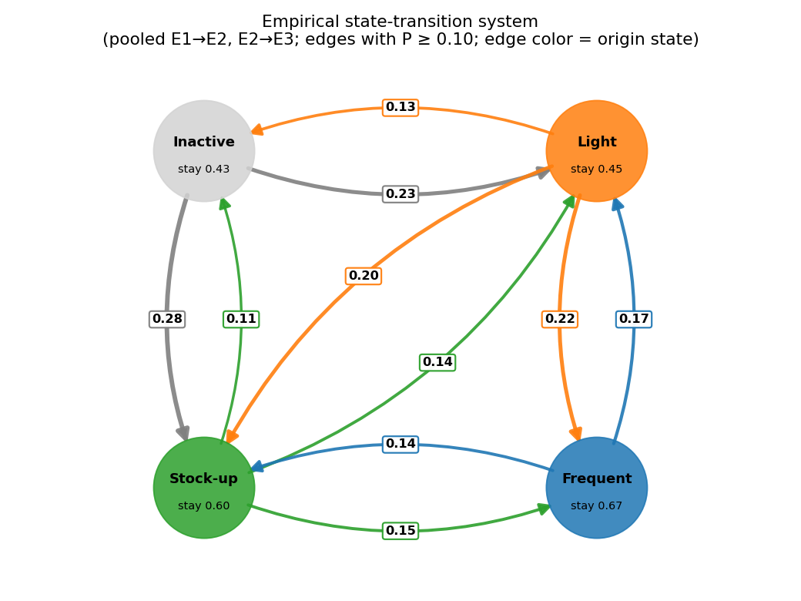
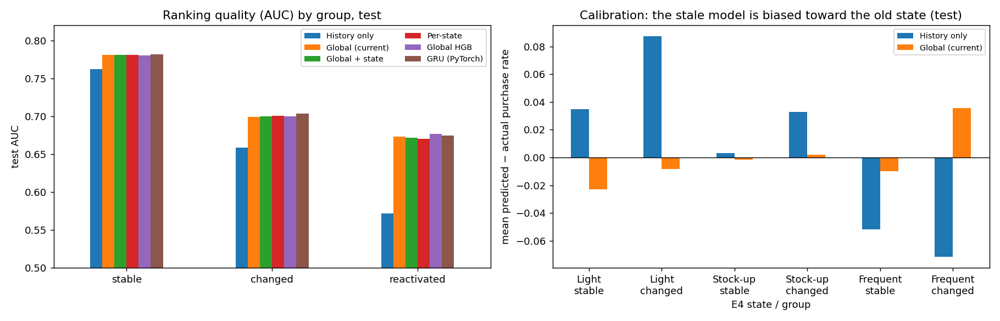

# Behavioral State Modeling Under Distribution Shift

An analysis of how customer purchasing behavior changes over time, whether these changes can be represented as interpretable behavioral states, and how changing behavior affects the reliability of machine-learning models.

**Key results:** 45.8M retail purchase lines · 400K+ customers · four behavioral states · 0.68 ROC-AUC for predicting state changes · 0.022 additional AUC loss from stale features after state transitions

## Overview

Machine-learning models often rely on historical behavior to make predictions about customers. When that behavior changes, features that previously described a customer well may no longer reflect their current circumstances.

This project uses retail purchase histories from the X5 Retail Hero dataset to examine three related questions:

1. How can changes in customer behavior be measured reliably when purchase histories are sparse or incomplete?
2. Can customer behavior be represented as a small set of interpretable states, and can transitions between those states be predicted?
3. How does behavioral change affect model reliability, and can state-aware models improve prediction and product targeting?

The project combines longitudinal data engineering, statistical drift analysis, unsupervised learning, interpretable transition modeling, and a downstream application using a randomized marketing experiment.

## Data

The analysis uses the [X5 Retail Hero uplift modeling dataset](https://ods.ai/competitions/x5-retailhero-uplift-modeling/data), which contains grocery purchases and a randomized SMS marketing campaign from 2019.

| Dataset | Contents |
|---|---|
| `purchases.csv` | 45,786,568 product-line records from November 21, 2018 through March 18, 2019 |
| `clients.csv` | 400,162 customers, loyalty-card issue date, age, and gender |
| `products.csv` | Product taxonomy, with approximately 43 category groups used in the analysis |
| `uplift_train.csv` | 200,039 customers with randomized treatment assignment and a post-campaign purchase outcome |
| `uplift_test.csv` | 200,123 customers without an observed campaign outcome |

Raw data files are excluded from the repository.

### Temporal Design

Purchase histories were divided into four consecutive 28-day periods preceding the marketing campaign:

| Period | Dates |
|---|---|
| E1 | Nov 27 – Dec 24, 2018 |
| E2 | Dec 25, 2018 – Jan 21, 2019 |
| E3 | Jan 22 – Feb 18, 2019 |
| E4 | Feb 19 – Mar 18, 2019 |

This design makes it possible to compare historical behavior with more recent behavior without using post-campaign information to construct predictors.

An important limitation is that all competition customers are active in E4 by construction. Consequently, E4 is not an independently sampled snapshot of the customer population.

## Data Engineering and Methodology

### Transaction Reconstruction

Each purchase record represents a product line rather than a complete shopping transaction. The `purchase_sum` field repeats across lines within the same basket, so transactions were reconstructed before customer spending was aggregated.

The purchase file was processed in chunks, producing approximately 7.7 million transactions. These transactions were aggregated into customer-period features, including:

- Transaction frequency and total spending
- Average basket spending and basket size
- Purchase quantity and number of unique products
- Product-category composition
- Historical trends, recent deviations, and behavioral instability

This produced approximately 1.6 million customer-period observations across the four time windows.

### Customer Observability

An initial data-quality issue emerged when interpreting periods with no recorded purchases. Approximately 36% of customers with zero purchases in E1 had not yet received a loyalty card.

Treating these customers as inactive would confuse an absence of observed behavior with genuine inactivity. The core state analysis therefore uses customers whose loyalty cards existed before E1 (177,600 of the 200,039 customers with campaign outcomes).

A related issue appeared when comparing E3 and E4. The apparent population-level distribution shift was substantially reduced when the comparison was restricted to active customers. This suggests that changes in which customers are observed can account for much of an apparent behavioral shift.

## Measuring Behavioral Change

Changes in transaction frequency, spending, and basket characteristics were examined using standardized mean differences, Kolmogorov–Smirnov statistics, and paired within-customer comparisons.

Changes in purchasing composition were measured using Jensen–Shannon distance between product-category distributions.

### Observation Depth and Category Drift

The analysis found that customers with sparse purchase histories tended to have larger measured category drift, even when the observed changes did not provide strong evidence of a behavioral transition.

Before accounting for observation depth, category drift distinguished state switchers from customers who remained in the same state with a ROC-AUC of approximately 0.64. After comparing customers with similar amounts of purchase history, this fell to approximately 0.54.

The result illustrates why drift measurements need to account for the amount of available data. A large measured distribution change may reflect sampling variability rather than a meaningful change in customer behavior.

## Behavioral State Modeling

### Learning Interpretable States

KMeans clustering was used to summarize active customer behavior using three features: transaction frequency, average basket spending, and average unique products per basket.

Features were transformed and standardized before clustering. Candidate cluster counts were compared using inertia, silhouette scores, stability across random seeds, train-to-validation stability, and interpretability of the resulting groups.

Three active states were selected, alongside a rule-defined inactive state:

| State | Typical behavior |
|---|---|
| Inactive | No recorded transactions during the period |
| Light | Approximately 2 shopping trips per period, with small baskets |
| Stock-up | Approximately 3 trips per period, with large baskets |
| Frequent | Approximately 9 trips per period, with medium-sized baskets |

The distinction between Stock-up and Frequent customers is particularly useful: customers can reach similar levels of total spending through different purchasing patterns.

The learned active states were stable across seeds and splits (adjusted Rand index approximately 0.99). However, the silhouette score of approximately 0.34 suggests that behavior forms a continuum rather than four naturally separated groups. The states are therefore used as practical summaries of behavior, not as definitive customer types.

### State Transitions

Each customer was assigned a behavioral state in each period, producing sequences such as Light → Light → Stock-up → Frequent.

Empirical transition matrices were constructed to estimate the probability of moving between states. The primary transition analysis uses E1→E2 and E2→E3, avoiding the E4 activity-selection issue.

Approximately 56% of customers remained in the same state from one period to the next, compared with approximately 28% under an independence baseline.

<p align="center"></p>

The state-transition graph represents empirical transition probabilities, rather than a formally verified automaton.

### State Boundaries and Transition Noise

Customers near cluster boundaries switched states more frequently than customers whose behavior was well within a state:

- Near a state boundary: approximately 55% switching rate
- Deep inside a state: approximately 19% switching rate

This indicates that some observed transitions may reflect small movements around an artificial cluster boundary rather than substantial behavioral change. Distance-to-boundary and hysteresis analyses were used to examine this sensitivity.

## Predicting State Transitions

Shallow decision trees were used to investigate whether transitions could be described and predicted using readable conditions over behavioral features.

The prospective prediction task uses information available in the current period to predict whether a customer will switch states in the following period. This is distinct from descriptive rules that use observed changes between two periods to characterize a transition after it occurs.

An eight-rule decision tree achieved approximately 0.68 ROC-AUC for predicting state switches, compared with approximately 0.65 using boundary distance alone. The model maintained similar discrimination on the later E3→E4 transition.

However, predicting the destination state was substantially more difficult: the destination-state model did not outperform a baseline that assumed customers would remain in their current state.

These results suggest that current behavioral features contain useful information about transition risk, but do not fully determine the direction of future behavioral changes.

## Model Reliability Under Behavioral Change

The next analysis examined whether behavioral change affects the reliability of models predicting post-campaign purchases.

Models compared included logistic regression using historical or current features, models with explicit state labels, separate per-state models, Histogram Gradient Boosting, and a small PyTorch GRU using the monthly behavioral sequence.

### Historical vs. Current Behavior

Models relying on historical features tended to make errors in the direction of customers' previous behavior. For example:

- Customers who became Frequent had their purchase probability underestimated by approximately 7 percentage points.
- Customers who became Light had their purchase probability overestimated by approximately 9 percentage points.

Using current-period features removed much of this systematic error.

The performance loss associated with stale features was also greater among customers who changed state: the additional ROC-AUC loss was **0.022 (95% bootstrap CI: 0.008–0.034)**.

<p align="center"></p>

### Do State-Aware Models Improve Prediction?

At first, customers who changed states appeared much harder to predict than stable customers, with an overall ROC-AUC gap of approximately 0.082.

However, after accounting for their current behavioral state, the gap fell to approximately 0.008 (95% CI: −0.012 to 0.030). Much of the original difference was attributable to differences in the composition of the two groups rather than evidence of an independent effect of switching states.

Adding explicit state labels to models with current behavioral features improved ROC-AUC by at most 0.002. A GRU trained on the monthly sequence provided a small additional gain of approximately 0.004 among customers who changed state.

The principal finding is that behavioral states were more useful for diagnosing model errors than for improving raw predictive performance. Keeping behavioral features current mattered more than adding discrete state labels or more complex models.

## Product Targeting and Randomized Experimentation

A separate downstream analysis investigated whether behavioral information could improve decisions about which customers should receive a marketing message.

The dataset contains a randomized SMS campaign, making it possible to estimate incremental treatment effects rather than simply predicting which customers are most likely to purchase.

### Treatment Effects by Behavioral State

The campaign increased purchase incidence by approximately 3.32 percentage points overall. Treatment effects differed across the current behavioral states:

| State | Estimated treatment effect |
|---|---:|
| Light | +5.0 percentage points |
| Stock-up | +2.4 percentage points |
| Frequent | +1.9 percentage points |

The Light–Frequent difference was statistically distinguishable from zero. Because treatment was randomized, these estimates describe how campaign effects vary across observed pre-treatment groups; they do not establish that changing a customer's state would change their treatment response.

### Static vs. Adaptive Targeting

S-learner and T-learner uplift models were compared using static behavioral summaries and adaptive features capturing more recent behavior and temporal change. Targeting strategies were evaluated at several contact budgets using estimated incremental purchases and cumulative incremental-gain curves.

Adaptive features showed the most consistent advantage at 20–30% contact budgets, outperforming static features in 9 of 10 seed runs. On the locked test cohort, the estimated improvements were approximately 46–50 incremental purchases per 10,000 messages at these budgets.

However, paired bootstrap confidence intervals included zero. The results therefore suggest a potential targeting improvement, but do not establish that adaptive targeting is reliably superior.

## Evaluation and Reproducibility

All notebooks share a fixed 60/20/20 customer split, stratified by treatment assignment and outcome. Scalers, clustering models, thresholds, and predictive models are fitted on training customers, with validation used for model-selection decisions and held-out test customers used for evaluation.

The transition prediction analysis additionally evaluates performance on a later time transition. Random-seed sensitivity and paired bootstrap intervals are used to examine uncertainty in key results.

## Practical Implications

The analysis supports several conclusions for customer analytics and model monitoring:

**Distinguish missing observation from genuine behavioral change.** Sparse purchase histories and differences in customer eligibility can inflate drift measurements or make customers appear inactive.

**Use behavioral states to diagnose model failures.** Interpretable states help identify which groups are likely to experience systematic prediction errors when historical features become outdated.

**Prioritize current information over unnecessary complexity.** Updating behavioral features removed much of the observed prediction bias, while explicit state labels and sequence models produced only small additional gains.

**Evaluate decisions separately from prediction accuracy.** A customer who is likely to purchase is not necessarily a customer whose purchase decision can be influenced by a marketing message. Randomized treatment-effect analysis provides a more appropriate framework for evaluating targeting strategies.

## Limitations and Future Work

Several limitations are important:

- The data cover one retailer, one campaign, and four periods. Seasonal effects, including the New Year period, cannot be separated reliably from longer-term trends.
- E4 activity is required by the dataset's construction, limiting comparisons with earlier periods.
- Only one post-campaign outcome window is available. The analysis measures covariate shift and model reliability, not changes in the conditional outcome distribution across multiple periods (concept drift in the strict sense).
- KMeans states are empirical summaries of continuous behavior, and state assignments can be sensitive to boundary noise.
- Transition rules are statistical predictions with error rates, not formally specified or verified conditions.
- The targeting improvements remain uncertain on the held-out test cohort.

A natural extension would be to learn more explicit transition conditions over behavioral sequences, represent them using temporal logic, and investigate whether automata learning or formal verification could improve the consistency and interpretability of state-transition systems. Accounting for noisy and sparse observations would be an important part of that extension.

## Repository Structure

```text
retail-behavioral-states/
├── notebooks/
│   ├── 01_data_ingestion.ipynb
│   ├── 02_drift_and_states.ipynb
│   ├── 03_state_aware_modeling.ipynb
│   └── 04_product_targeting.ipynb
├── figures/
├── data/                         # Local only; excluded from Git
│   ├── raw/
│   └── processed/
├── .gitignore
├── README.md
└── requirements.txt
```

## Reproducing the Analysis

1. Download the five CSV files from the [X5 Retail Hero competition data page](https://ods.ai/competitions/x5-retailhero-uplift-modeling/data).
2. Place the files in `data/raw/`.
3. Install dependencies:

   ```bash
   pip install -r requirements.txt
   ```

4. Run notebooks 01–04 sequentially. The notebooks create processed datasets and figures used in subsequent analyses.

Notebook 01 processes the purchase file in chunks. Notebook 03 trains the GRU on CPU and caches trained models in `data/processed/gru_models/`; delete that directory to retrain them.

## Tools and Technologies

- **Data Analysis:** Python, Pandas, NumPy, SciPy, PyArrow
- **Statistical Analysis:** Distribution comparisons, Jensen–Shannon distance, bootstrap confidence intervals, randomized treatment-effect estimation
- **Machine Learning:** scikit-learn, KMeans, Decision Trees, Logistic Regression, Histogram Gradient Boosting, S-/T-learner uplift modeling
- **Sequence Modeling:** PyTorch GRU
- **Visualization:** Matplotlib
- **Version Control:** Git, GitHub
