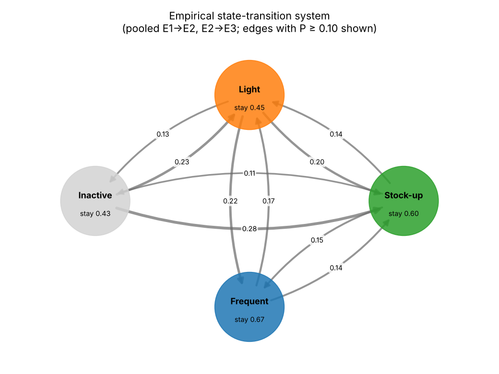
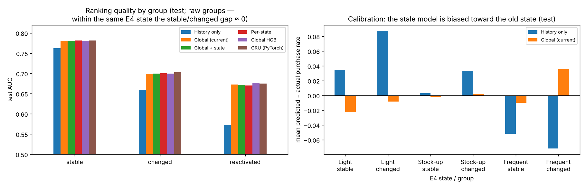

# Behavioral State Modeling Under Distribution Shift

**Can changes in customer behavior be detected, described, and represented as a small set of interpretable behavioral states — and do state-aware models stay more reliable when behavior changes?**

This project studies 45.8 million retail purchase lines from 400,162 customers (X5 Retail Hero) over four consecutive 28-day periods. It builds a simple, explainable pipeline:

```
raw transactions → temporal behavior → distribution change → behavioral states → state transitions
               → interpretable transition rules → global vs state-aware models → product targeting decision
```

The emphasis is on **trustworthy measurement**: several apparent signals of "behavioral change" turned out to come from how the data was observed, and the project documents how they were detected and corrected. Methods are deliberately lightweight (statistics, scikit-learn, one small PyTorch model) so every step can be explained.

---

## Key findings

| # | Finding | Where |
|---|---|---|
| 1 | **Part of the "inactivity" is non-observation.** 36% of customers with zero purchases in the first period did not yet have a loyalty card. | 02 §0 |
| 2 | **Population-level shift is mostly about who is active, not how people shop.** The large E3→E4 shift (SMD 0.3–0.5) disappears among active customers (all \|SMD\| ≤ 0.1), because the sample requires activity in E4. | 02 §A |
| 3 | **Four interpretable states:** Inactive, Light (~2 trips/month, small baskets), Stock-up (~3 trips, large baskets), Frequent (~9 trips, medium baskets). Stable across seeds and splits (ARI ≈ 0.99), but a continuum rather than natural clusters (silhouette ≈ 0.34). | 02 §B |
| 4 | **States persist, but much switching is boundary noise.** 56% stay in the same state month to month (vs ≈ 28% by chance). Customers near a state boundary switch 55% of the time; those deep inside a state, 19%. | 02 §C |
| 5 | **Category drift is confounded by observation depth.** Jensen–Shannon drift separates state switchers from stayers with AUC 0.64, falling to 0.54 once customers with similar history depth are compared. An apparent link between drift and treatment response (2.1 → 4.9 pp) flattens after the same adjustment. | 02 §D |
| 6 | **Readable switching rules work modestly and remain stable over time.** An 8-rule decision tree predicts upcoming switches with AUC 0.68 (vs 0.65 for boundary distance alone), with the same accuracy on the later E3→E4 transition. The *destination* state is not predictable beyond "stays put". | 03 §E |
| 7 | **Models fail when they have not seen a behavioral change.** A history-only model is biased toward the customer's *old* state: it under-predicts purchases of customers who just became Frequent by 7 pp and over-predicts those who just became Light by 9 pp (95% CIs exclude 0). Using current behavior removes most of this. | 03 §F |
| 8 | **Explicit state labels add little once current behavior is used** (AUC change ≤ 0.002). A small PyTorch GRU over the monthly sequence adds a small but statistically clear gain (+0.004 AUC on customers who changed state). The apparent "changed customers are harder to predict" gap (0.082 AUC) is mostly group composition (0.008 within the same state). | 03 §F |
| 9 | **The message's effect differs by state:** +5.0 pp for Light customers vs +1.9 pp for Frequent (p < 0.001). | 04 §6c |
| 10 | **Targeting results were sensitive to random seeds.** Re-running with 10 seeds showed that only the gain at 20–30% contact budgets is robust (adaptive features win 9/10 seeds); earlier single-run headlines were replaced. | 04 §6b |

**Short answer to the research question:** behavioral change does cause predictable, describable model failures — but in this data the fix is to use current behavior, not to add discrete states. States are most valuable as a *diagnostic lens*: they show which customers a model gets wrong and in which direction.

<p align="center"></p>

<p align="center"></p>

---

## Data

[X5 Retail Hero uplift modeling](https://ods.ai/competitions/x5-retailhero-uplift-modeling/data) (Russian grocery retailer, 2019). The data is not included in this repository.

| File | Contents |
|---|---|
| `purchases.csv` | 45,786,568 product lines (4.4 GB), 2018-11-21 to 2019-03-18 |
| `clients.csv` | 400,162 customers, card issue date, age, gender |
| `products.csv` | product taxonomy (level_2 ≈ 43 categories used) |
| `uplift_train.csv` | 200,039 customers with randomized SMS treatment and post-campaign purchase outcome |
| `uplift_test.csv` | 200,123 customers without outcome |

**Design.** Pre-campaign purchase history → randomized message (`treatment_flg`) → purchase afterwards (`target`). History is split into four 28-day periods: E1 (Nov 27 – Dec 24), E2 (Dec 25 – Jan 21), E3 (Jan 22 – Feb 18), E4 (Feb 19 – Mar 18).

**Data handling to know about**
- Each row of `purchases.csv` is a product line, and `purchase_sum` repeats across lines of the same basket; transactions are reconstructed before spend is aggregated.
- All competition customers are active in E4 by construction, so E4 is not a random snapshot.
- State analysis uses customers whose card existed before E1 (177,600 of 200,039), so that zero purchases mean "inactive", not "not yet a customer".

---

## Notebooks

Run in order. Each notebook explains for every section the question, the method, the result, and its limitations.

| Notebook | Purpose | Runtime* |
|---|---|---|
| [`01_data_ingestion`](notebooks/01_data_ingestion.ipynb) | One streaming pass over the 4.4 GB file: transactions, customer-period behavior, temporal change features, category composition, Jensen–Shannon drift, observation-depth check | ~1 min |
| [`02_drift_and_states`](notebooks/02_drift_and_states.ipynb) | §A distribution change (SMD, KS) · §B behavioral states (KMeans) · §C transition matrices, state graph, boundary noise · §D do drift measures track state switches? | ~2 min |
| [`03_state_aware_modeling`](notebooks/03_state_aware_modeling.ipynb) | §E interpretable transition rules (decision trees) · §F global vs state-aware models and a PyTorch GRU, reliability after state change with bootstrap CIs · §H bridge to formal state-transition modeling | ~1.5 min |
| [`04_product_targeting`](notebooks/04_product_targeting.ipynb) | Product application: uplift targeting with the randomized experiment, static vs adaptive features, seed sensitivity, treatment effect by behavioral state | ~1.5 min |

\*Measured on a laptop-class CPU. `notebooks/archive/` holds the original exploratory versions (kept for history; their data paths assume the old location).

**Evaluation discipline.** One fixed customer split (60/20/20, stratified on treatment × outcome, `random_state=42`) is shared by all notebooks. Scalers, clusters, thresholds and models are fit on training customers; choices are made on validation; the test set is used once per analysis. Results that depend on randomness are repeated across seeds.

---

## Methods

| Area | Methods |
|---|---|
| Distribution change | standardized mean difference, Kolmogorov–Smirnov statistic, paired within-customer change |
| Composition drift | Jensen–Shannon distance between category distributions, stratification by observation depth |
| States | log transform, StandardScaler, KMeans (K chosen by inertia, silhouette, seed and train→validation stability, interpretability) |
| Transitions | empirical transition matrices, independence baseline, distance-to-boundary margin, hysteresis threshold |
| Transition rules | shallow `DecisionTreeClassifier`, temporal hold-out (fit on E1→E3, test on E3→E4) |
| Prediction reliability | logistic regression, per-state models, HistGradientBoosting, PyTorch GRU; AUC, log loss, calibration gap; paired bootstrap CIs |
| Causal targeting | randomized treatment-effect estimates, S-/T-learner uplift models, policy value at contact budgets, Qini-style area |

---

## Limitations

- One retailer, one campaign, four months. Seasonality (the New Year falls inside E2) cannot be separated from trend.
- Only one outcome window exists, so changes in P(Y | X) across periods (concept drift in the strict sense) cannot be tested — the project measures covariate shift and model reliability.
- Behavioral states are observational. Differences in treatment response by state describe *who* responds, not what *causes* response.
- Transition rules are empirical statistical rules with error rates, not formally specified or verified conditions.

## Future work

The system built here — finite states, empirical transition probabilities, readable transition conditions, per-state models — is an *empirical* finite-state transition system. Natural next steps toward formal, verifiable state-transition models (see notebook 03 §H):

1. express transition conditions in a temporal logic (e.g. Signal Temporal Logic) instead of single-month thresholds;
2. learn a compact automaton consistent with the observed sequences (automata learning / SMT-based synthesis);
3. formally check learned conditions for consistency and coverage;
4. model noise explicitly with probabilistic transitions and drift tests that account for sparse observations;
5. learn states and per-state models jointly.

---

## How to run

```bash
pip install -r requirements.txt
```

1. Download the five CSV files from the [competition data page](https://ods.ai/competitions/x5-retailhero-uplift-modeling/data) into `data/raw/`.
2. Run `notebooks/01` → `02` → `03` → `04` in order. Each writes its outputs to `data/processed/` and `figures/`.

Notebook 01 reads the purchase file in 1M-row chunks and needs only a few GB of memory.

## Repository structure

```
├── data/
│   ├── raw/                 # downloaded CSVs (not tracked)
│   └── processed/           # model_data, customer_period, category_drift, customer_states (.parquet)
├── figures/                 # all saved charts
├── notebooks/
│   ├── 01_data_ingestion.ipynb
│   ├── 02_drift_and_states.ipynb
│   ├── 03_state_aware_modeling.ipynb
│   ├── 04_product_targeting.ipynb
│   └── archive/             # original exploratory notebooks
├── requirements.txt
└── README.md
```
